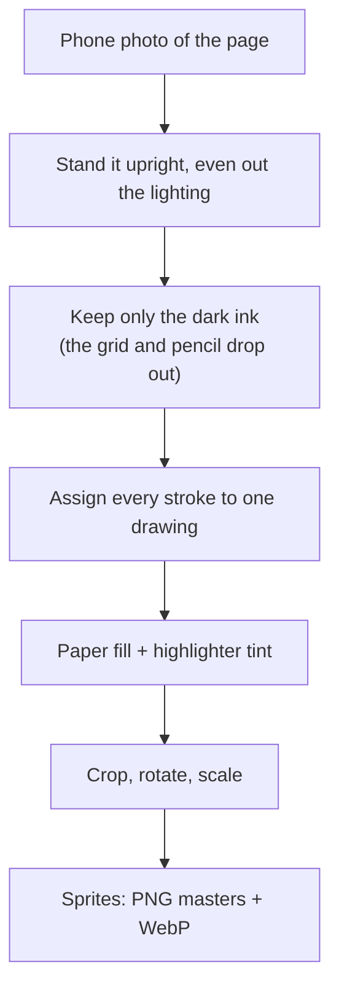
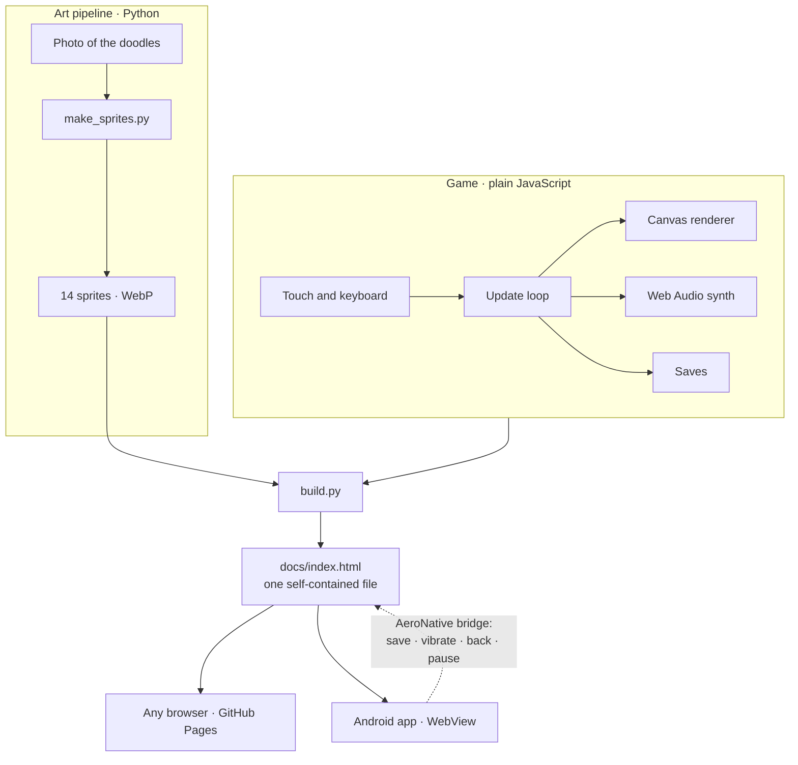
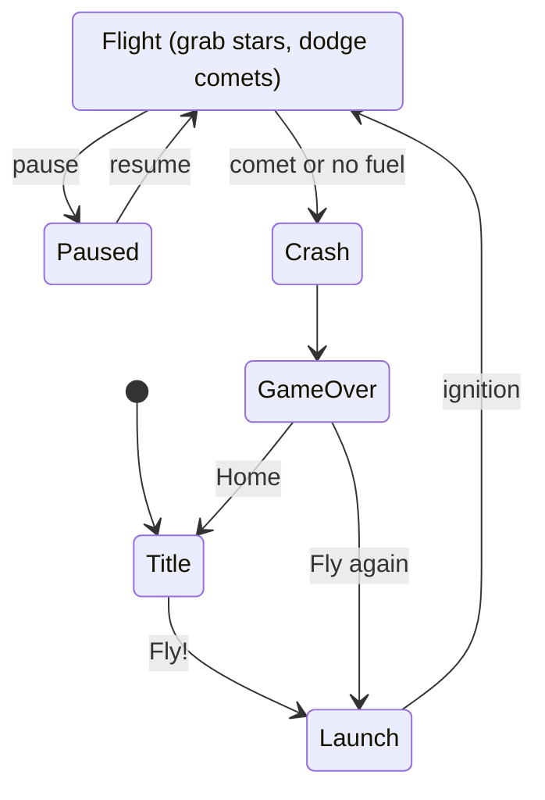

<div align="center">


**A doodle-powered space flight for Android.**
*Fly a cat-crewed rocket from your garden into space, dodge the comets, and grow the garden with every star you bring home.*

**Every drawing in the game was drawn by hand by Kamal Ballage, in ballpoint pen.**


</div>

---

## Table of contents

- [Overview](#overview)
- [What makes it special](#what-makes-it-special)
- [Screenshots](#screenshots)
- [Play](#play)
- [How to play](#how-to-play)
- [The art](#the-art)
- [Architecture](#architecture)
- [Tech stack](#tech-stack)
- [By the numbers](#by-the-numbers)
- [Repository structure](#repository-structure)
- [Getting started](#getting-started)
- [Lessons learned](#lessons-learned)
- [Limitations and roadmap](#limitations-and-roadmap)
- [Privacy](#privacy)
- [Credits](#credits)

---

## Overview

Many games start from a style guide. AERO.CAT started from **one page of doodles**: a rocket with a kitten on board, a comet, a galaxy, a cat sitting on a ringed planet, a few stars, a tree and a flower in a pot. They were drawn by **Kamal Ballage** in ballpoint pen on French-ruled notebook paper, photographed, cut out by a script, and turned into a game with plain JavaScript.

A flight has five beats:

1. **Launch**: the AERO.CAT rocket lifts off from the pad in the garden.
2. **Collect**: stars are stardust fuel. The engine burns it all the time, so you keep chasing them.
3. **Dodge**: comets come in at an angle, announced by a red **!** at the edge of the screen.
4. **Boost**: fly into a galaxy to warp, or touch the cat planet for a cat-bubble shield.
5. **Grow**: the stardust you bring home grows the garden, and each stage unlocks a perk for the next flight.

> Nothing in the game was redrawn or traced. The sprites are the original pen lines. The only additions are a paper-white fill behind each drawing and a light highlighter tint.

---

## What makes it special

**▸ Every sprite is a real doodle.** All 14 sprites were cut out of one photographed page. The pen texture, the hatching and the wobbly lines are the original strokes, not a "sketchy" filter.

**▸ A garden that remembers.** Stardust carries over between flights. The sprout becomes a daisy, the tree grows through six stages, and each stage unlocks a perk. The home screen is the save file.

**▸ A cat that saves you.** The cat planet gives you a cat-bubble shield that absorbs one comet hit. When it does, a **"saved by the cat!"** pops up.

**▸ Fair warnings.** Every comet is announced about a second early, by a red **!** at the exact edge it will enter from, with an arrow showing which way it's flying. Comet showers always leave one gap.

**▸ Stars are fuel, not just points.** The engine burns stardust constantly (about twelve seconds of fuel without any stars), so you can't just hide from comets. Star patterns (zigzags, rings, forks with a big star on one side) make you choose a route.

**▸ Everything you hear is synthesized.** The music, the star chimes, the warp whoosh and even the meow are generated live with the Web Audio API. The game contains no audio files.

**▸ One file, zero dependencies.** The whole game (code, sprites, font) is a single ~600 KB HTML file with no libraries. The Android app is that file inside a WebView.

**▸ An APK without Gradle.** `android/build.sh` assembles the APK from a handful of command-line tools. The build is one short script, and the GitHub workflow needs no SDK setup.

**▸ A sprite pipeline you can re-run.** `tools/make_sprites.py` rebuilds every sprite from the original photo, pixel for pixel.

---

## Screenshots

<p align="center">
  
  <br>
  <em>A flight, recorded from the game itself: grab the cat planet, get saved by its shield, then warp through a galaxy.</em>
</p>

<table align="center">
  <tr>
    <td align="center"><br><sub>The garden and the launch pad</sub></td>
    <td align="center"><br><sub>Comets, warnings and stars</sub></td>
    <td align="center"><br><sub>A galaxy and the cat planet</sub></td>
    <td align="center"><br><sub>The garden grows after a flight</sub></td>
  </tr>
</table>

---

## Play

**Android**

1. Open the [Actions](../../actions) tab, pick the latest successful **Build APK** run, and download `AeroCat.apk` from **Artifacts** (GitHub asks you to sign in).
2. Open the file on your phone and allow installs from that app when Android asks.
3. Play Protect may warn about an unknown developer, because the app is signed with a personal key. Tap **Install anyway**.

Works on Android 5.0 and newer.

**Browser**

[`docs/index.html`](docs/index.html) is the entire game in one file: download it and open it in any browser. To play it online, turn on GitHub Pages (**Settings → Pages → Deploy from a branch → `main` / `/docs`**), and it will be served at `https://knizmo.github.io/aero-cat/`.

---

## How to play

| Control | |
|---|---|
| **Steer** | Drag anywhere on the screen. On a keyboard: ← → or A / D |
| **Pause** | The **II** button, the Android Back button, or P / Esc |

<table>
  <tr>
    <th width="120">Pickup</th>
    <th>What it does</th>
  </tr>
  <tr>
    <td align="center">  <br><b>Stars</b></td>
    <td>Stardust fuel and score. Small stars are worth 1, the long sparkle 3, the big one 5. Bigger stars refill more fuel.</td>
  </tr>
  <tr>
    <td align="center"><br><b>Comets</b></td>
    <td>Hit one and the flight is over. A red <b>!</b> shows where the next one enters. Passing very close to one earns <b>+1</b> ("close one!").</td>
  </tr>
  <tr>
    <td align="center"><br><b>Galaxy</b></td>
    <td>Fly into the swirl for <b>3 seconds of warp</b>: 2.4× speed, nothing can hurt you, nearby stars are pulled in, and comets you touch are smashed for <b>+2</b> each.</td>
  </tr>
  <tr>
    <td align="center"><br><b>Cat planet</b></td>
    <td>Touch it for a <b>cat-bubble shield</b> that absorbs one comet hit. If you already have a shield, you get <b>+3</b> stardust instead.</td>
  </tr>
  <tr>
    <td align="center"><br><b>Out of fuel</b></td>
    <td>The engine sputters and the rocket falls. Grab a star in time and it recovers.</td>
  </tr>
</table>

### The garden

Stardust is saved after every flight. Each stage of the garden unlocks a perk that applies to every flight after it.

| Stardust | Stage | Perk |
|---:|---|---|
| 0 | Empty pot | A small tree and an empty pot |
| 40 | Sprout | Fuel tank +25% |
| 120 | Daisy bloom | Every flight starts with a cat shield |
| 250 | Young tree | Star magnet |
| 450 | Tall tree | Warp lasts 1.5 s longer |
| 750 | Star-fruit tree | Stars give 50% more fuel |
| 1200 | Starlit garden | Big stars are worth double |

---

## The art

<p align="center">
  
  <br>
  <em>The original page: ballpoint pen on French-ruled notebook paper. All drawings by Kamal Ballage.</em>
</p>

Every drawing on that page has a job in the game:

| Drawing | Becomes |
|---|---|
|  | **The AERO.CAT rocket**, the player's ship. Its flame is cut out separately so it can flicker, and its hand-lettered name became the title logo |
|  | **The comet**, the hazard. Turned so its tail points straight up |
|  | **The galaxy**, the warp portal. It spins slowly |
|  | **The cat planet**, the shield pickup. It bobs and purrs (well, meows) |
|     | **The stars**, the fuel and the score. Four doodled stars, four sizes of reward |
|    | **The flower pot**, split into pot, sprout and daisy: the first two garden stages |
|  | **The tree**, which grows with your stardust |

`tools/make_sprites.py` does the cutting:



1. **Lighting.** The photo is turned upright and the paper's brightness is estimated with a wide percentile filter, so shadows and the phone's lighting cancel out.
2. **Ink.** Ink is whatever is much darker than the local paper. The printed grid and the old pencil marks are lighter, so they drop out, and what remains becomes a soft alpha mask that keeps the pen texture.
3. **Ownership.** Every stroke is assigned to one drawing using hand-placed regions.
4. **Cut-out.** Each drawing is filled with paper white behind the ink, so it reads as a cut-out, and gets a light highlighter wash (yellow stars, green leaves, a blue planet, a terracotta pot).
5. **Output.** The sprite is cropped, rotated if needed and scaled. Lossless masters go to `art/sprites/`, the WebP files the game uses go to `game/assets/`, and anchor points (like where the flame attaches to the rocket) go to `art/sprites/meta.json`.

---

## Architecture



A flight is a small state machine:



**Design choice: a WebView around one HTML file, not a native app.** The same code runs in a browser, on GitHub Pages and inside the APK. The only native code is a ~140-line Java activity that provides saves (SharedPreferences), vibration, pause when the app goes to the background, and the Back button.

**Design choice: the world is endless but fair.** Stars come in hand-designed patterns (lines, zigzags, sine sweeps, rings, forks, risky lone stars). Comet frequency and speed rise with distance, and the first comets don't arrive until a few seconds in.

---

## Tech stack

| Component | Role |
|---|---|
| **HTML5 Canvas 2D** | Rendering, with parallax notebook paper that turns slightly bluer as you climb |
| **Vanilla JavaScript** | The whole game: physics, spawning, collisions, UI, saves |
| **Web Audio API** | Live-synthesized music and sound effects |
| **Java · Android WebView** | The APK: full screen, saves, haptics, lifecycle |
| **aapt2 · javac · dx · zipalign · apksigner** | APK build without Gradle (signing: v1 + v2 + v3) |
| **Python · NumPy · SciPy · OpenCV · Pillow · Matplotlib** | Sprite and icon pipeline |
| **GitHub Actions** | Builds the APK on every push |
| **Patrick Hand** | The handwriting font for the interface |

---

## By the numbers

| | |
|---|---|
| Hand-drawn sprites | 14 |
| Game code | 1 file, ~1,200 lines of plain JavaScript |
| Web build | ~600 KB, one HTML file with everything inlined |
| Android APK | ~640 KB |
| Minimum Android | 5.0 (API 21) |
| Permissions | 1 (vibration) |
| Runtime dependencies | 0 |
| Audio files | 0 |

---

## Repository structure

```
aero-cat/
├── game/
│   ├── src/                 index.html, style.css, game.js  (the whole game)
│   ├── assets/              the 14 sprites (WebP)
│   ├── font/                Patrick Hand + its licence
│   └── build.py             bundles everything into docs/index.html
├── docs/index.html          the built game, one file (also served by GitHub Pages)
├── android/
│   ├── src/                 MainActivity.java (WebView host + native bridge)
│   ├── res/                 launcher icons and theme
│   ├── AndroidManifest.xml
│   └── build.sh             builds and signs AeroCat.apk, no Gradle
├── art/
│   ├── original-drawing.jpg the photo of the original doodles
│   └── sprites/             lossless sprite masters + meta.json (anchors)
├── tools/
│   ├── make_sprites.py      photo -> sprites
│   ├── make_icons.py        sprites -> launcher icons and README logo
│   └── requirements.txt
├── screenshots/             README images
└── .github/workflows/
    └── build.yml            builds the APK on every push
```

---

## Getting started

### Prerequisites

| To do this | You need |
|---|---|
| Play or rebuild the web version | A browser. Python 3 to rebuild (no packages) |
| Build the APK | Ubuntu, Debian or WSL, with the packages below |
| Regenerate the sprites | Python 3 and `pip install -r tools/requirements.txt` |

### Run it in a browser

Open `docs/index.html`. To rebuild it after changing anything in `game/`:

```bash
python3 game/build.py        # -> docs/index.html
```

Commit the rebuilt `docs/index.html` together with your changes, so GitHub Pages serves the latest version.

### Build the Android APK

```bash
sudo apt install aapt apksigner zipalign android-sdk-platform-23 dalvik-exchange default-jdk-headless zip python3
bash android/build.sh        # -> android/AeroCat.apk
```

On Windows, run this inside WSL (Ubuntu). Or let GitHub build it: every push to `main` runs `.github/workflows/build.yml`, and the APK appears under that run's **Artifacts**.

### Signing

The signing key is never committed (`*.jks` is in `.gitignore`). `build.sh` signs with `android/aerocat.jks` and creates it on the first build (default password `aerocat-pass`; set `AEROCAT_KEYSTORE_PASS` before the first build to pick your own). Keep that file safe and backed up: Android only installs an update over an existing install if both are signed with the same key.

To sign the GitHub builds with your own key, add two repository secrets (**Settings → Secrets and variables → Actions**):

- `KEYSTORE_BASE64`: the output of `base64 -w0 android/aerocat.jks`
- `KEYSTORE_PASSWORD`: the keystore password

Without them, each GitHub build is signed with a new throwaway key. That's fine for testing, but you have to uninstall the previous version before installing a new one.

### Sprites and icons

```bash
pip install -r tools/requirements.txt
python3 tools/make_sprites.py   # photo -> art/sprites/*.png + game/assets/*.webp
python3 tools/make_icons.py     # -> android/res launcher icons + screenshots/app-icon.png
```

With the same library versions, running both reproduces the shipped sprites and icons pixel for pixel.

---

## Lessons learned

What came up while turning a photo into a game, and what it taught:

- **A phone photo is not a scan.** The lighting is uneven across the page, so one fixed brightness threshold would have to choose between losing the faint hatching and keeping the shadows. Comparing each pixel with the paper brightness *around it* avoids the choice, and the lighter printed grid disappears for free.
- **Drawings that touch need a human.** A star touched an arm of the galaxy, and the flower stem touched the pot rim. Strokes are therefore assigned to drawings with hand-placed regions, and the last few stray pixels are cleaned by script.
- **Not everything should be a sprite.** The three little speed dashes next to the rocket looked like blurry smudges once scaled up for the warp effect, so warp streaks are drawn as thin pen lines in code instead.
- **Balance by simulation.** Bots of four skill levels played thousands of metres in fast-forward. The first pass was too generous with fuel, so star refills went down and the burn rate went up, until the tank runs dry in about twelve seconds without stars.
- **Sound by measurement.** Every effect was rendered offline and its loudness measured. The warning beeps and the warp whoosh turned out to be nearly inaudible next to the crash, so they were raised.
- **The APK doesn't need Gradle.** The environment the game was built in couldn't download the Android SDK or Gradle, so the APK is assembled from distro packages instead. It turned out simpler: one short script, and the CI workflow only needs `apt install`.

---

## Limitations and roadmap

**Limitations**

- Portrait only
- Mostly tested in a phone-sized browser. Reports from more real Android devices are welcome
- Speed depends on the device's WebView
- The APK is signed with a personal key, so installing it needs "unknown sources" and may trigger a Play Protect warning
- Progress is saved on the device only: no cloud backup, no leaderboard

**Ideas for later**

- More of Kamal's doodles: new hazards, new pickups, new stages for the garden
- A daily challenge with the same stars and comets for everyone
- A local leaderboard
- French and Arabic interface
- A Play Store release with a proper release key

---

## Privacy

- The app asks for **one** permission: vibration.
- It has no internet permission. It never sends anything anywhere, and has no ads and no analytics.
- Your best distance, your stardust and your sound setting are stored on your device.
- The font and every sprite are bundled in the app, so nothing is downloaded when you play.
- No signing key or secret is committed to this repository.

---

## Credits

**Author and artist**: Kamal Ballage ([@Knizmo](https://github.com/Knizmo)). All the drawings in this game are Kamal's own, hand-drawn in ballpoint pen on French-ruled notebook paper.

**Font**: [Patrick Hand](https://fonts.google.com/specimen/Patrick+Hand) by Patrick Wagesreiter, SIL Open Font License 1.1 (`game/font/OFL.txt`).

**Sound**: music and effects are synthesized live with the Web Audio API.

---

<div align="center">
  
  <br>
  <sub><em>Fly high, little cat.</em></sub>
</div>