<div align="center">

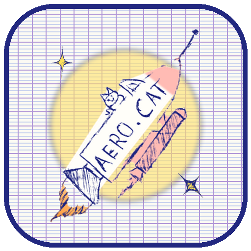

**A doodle-powered space game for Android.**
*Fly a little rocket (with a cat on board) from your garden into space, dodge the comets, and grow your garden with the stars you collect.*

**All the art is by me, drawn by hand :).**

🚧 **Work in progress: this game is not finished yet.**


</div>

---

## Table of contents

- [Overview](#overview)
- [What makes it special](#what-makes-it-special)
- [Screenshots](#screenshots)
- [Play](#play)
- [How to play](#how-to-play)
- [The art](#the-art)
- [How it's made](#hows-it-made)
- [Repository structure](#repository-structure)
- [Getting started](#getting-started)
- [Lessons learned](#lessons-learned)
- [Work in progress](#work-in-progress)
- [Privacy](#privacy)
- [Credits](#credits)

---

## Overview

AERO.CAT is a small space game made from **one page of my own doodles**: a rocket with a kitten on board, a comet, a galaxy, a cat sitting on a ringed planet, a few stars, a tree and a flower in a pot. I drew them by hand in ballpoint pen on notebook paper, and they were then cut out of a photo and turned into a game.

A flight goes like this:

1. **Launch** from the pad in your garden.
2. **Collect stars.** They are your stardust fuel, and the engine burns it all the time.
3. **Dodge comets.** A red **!** warns you where the next one is coming from.
4. **Use the boosts.** Fly into a galaxy to warp, or touch the cat planet for a cat-bubble shield.
5. **Grow your garden.** The stardust you bring home makes the garden grow and unlocks perks for your next flight.

> **Work in progress.** The game is playable, but it isn't finished. Things will change, and there are rough edges. See [Work in progress](#work-in-progress).

---

## What makes it special

**▸ Real doodles.** Every picture in the game is one of my drawings, with the original pen lines. The only things added are a paper-white fill behind each drawing and a light highlighter colour.

**▸ A garden that grows.** The stardust you collect is saved. The sprout becomes a daisy, the tree gets bigger, and each stage unlocks a perk.

**▸ A cat that saves you.** The cat planet gives you a shield that blocks one comet. When it does, you see **"saved by the cat!"**.

**▸ Fair warnings.** Every comet is announced about a second early, at the edge of the screen where it will come in.

**▸ Stars are fuel.** The engine runs out of stardust in about twelve seconds, so you always have a reason to go for the stars.

**▸ Handmade sound.** The music and the sound effects (even the meow) are made inside the game. There are no audio files.

**▸ Small and simple.** The whole game is one file of about 600 KB, and the Android app is about 640 KB.

---

## Screenshots

<p align="center">
  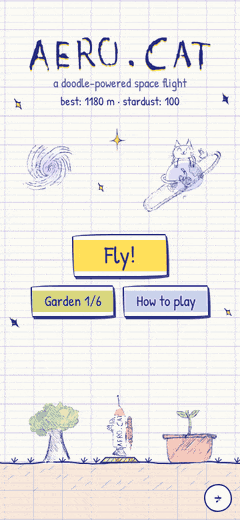
  <br>
  <em>A flight, recorded from the game itself: grab the cat planet, get saved by its shield, then warp through a galaxy.</em>
</p>

<table align="center">
  <tr>
    <td align="center">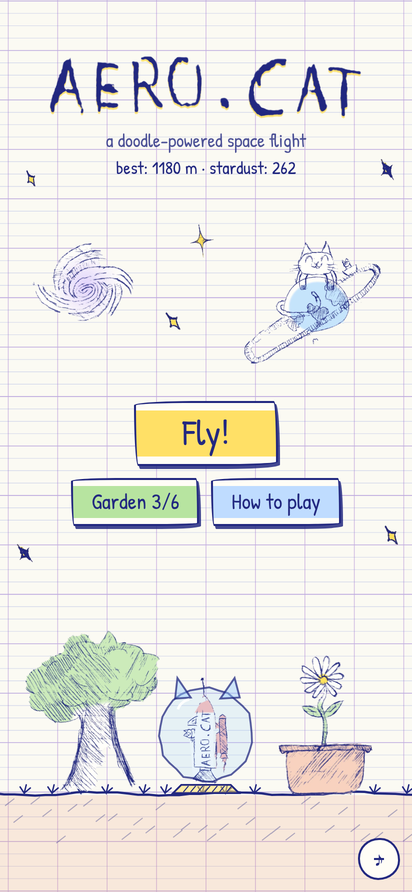<br><sub>The garden and the launch pad</sub></td>
    <td align="center">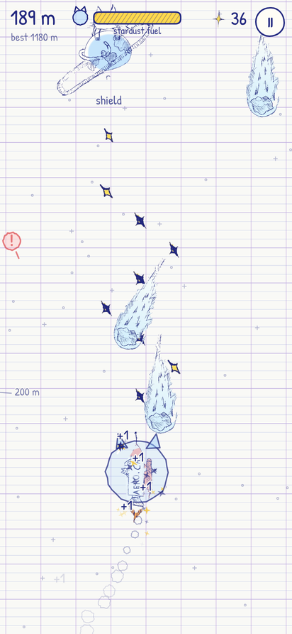<br><sub>Comets, warnings and stars</sub></td>
    <td align="center">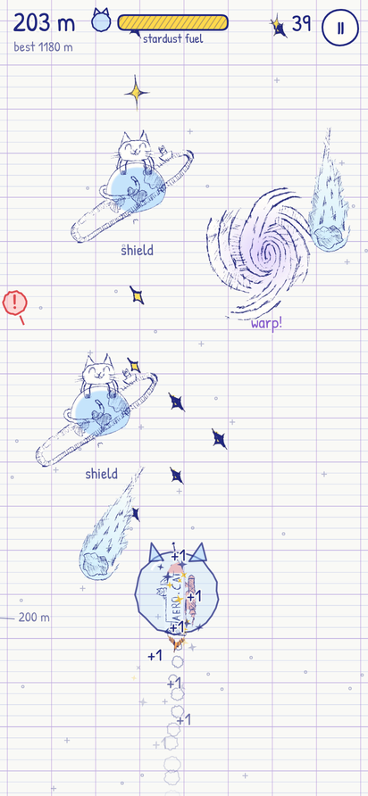<br><sub>A galaxy and the cat planet</sub></td>
    <td align="center">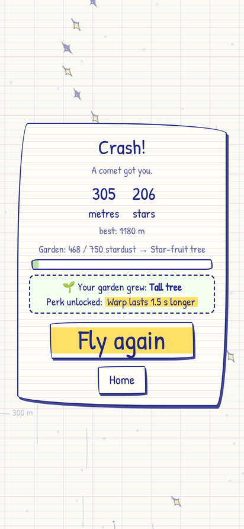<br><sub>The garden grows after a flight</sub></td>
  </tr>
</table>

---

## Play

**On Android**

1. Open the [Actions](../../actions) tab, pick the latest successful **Build APK** run, and download `AeroCat.apk` from **Artifacts** (GitHub asks you to sign in).
2. Open the file on your phone and allow installs from that app when Android asks.
3. Play Protect may warn about an unknown developer, because the app is signed with a personal key. Tap **Install anyway**.

It works on Android 5.0 and newer.

**In a browser**

[`docs/index.html`](docs/index.html) is the whole game in one file: download it and open it in any browser. To play it online, turn on GitHub Pages (**Settings → Pages → Deploy from a branch → `main` / `/docs`**). GitHub then shows you the link to the game.

---

## How to play

| Control | |
|---|---|
| **Steer** | Drag anywhere on the screen. On a keyboard: ← → or A / D |
| **Pause** | The **II** button, the Android Back button, or P / Esc |

<table>
  <tr>
    <th width="120">Pickup</th>
    <th>What it does</th>
  </tr>
  <tr>
    <td align="center">  <br><b>Stars</b></td>
    <td>Stardust fuel and score. Small stars are worth 1, the long sparkle 3, the big one 5. Bigger stars refill more fuel.</td>
  </tr>
  <tr>
    <td align="center">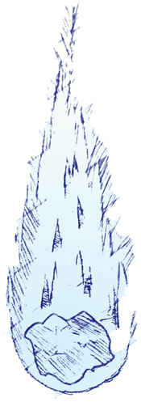<br><b>Comets</b></td>
    <td>Hit one and the flight is over. A red <b>!</b> shows where the next one enters. Passing very close to one earns <b>+1</b> ("close one!").</td>
  </tr>
  <tr>
    <td align="center">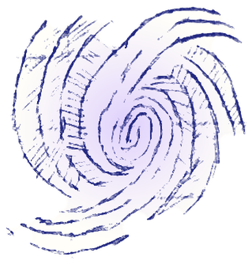<br><b>Galaxy</b></td>
    <td>Fly into the swirl for <b>3 seconds of warp</b>: you go faster, nothing can hurt you, nearby stars are pulled in, and comets you touch are smashed for <b>+2</b> each.</td>
  </tr>
  <tr>
    <td align="center">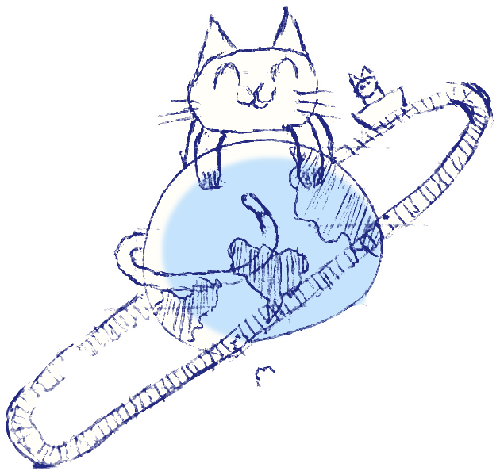<br><b>Cat planet</b></td>
    <td>Touch it for a <b>cat-bubble shield</b> that blocks one comet. If you already have a shield, you get <b>+3</b> stardust instead.</td>
  </tr>
  <tr>
    <td align="center"><br><b>Out of fuel</b></td>
    <td>The engine sputters and the rocket falls. Grab a star in time and it recovers.</td>
  </tr>
</table>

### The garden

Your stardust is saved after every flight. Each stage of the garden gives you a perk for all the flights after it.

| Stardust | Stage | Perk |
|---:|---|---|
| 0 | Empty pot | A small tree and an empty pot |
| 40 | Sprout | Fuel tank +25% |
| 120 | Daisy bloom | Every flight starts with a cat shield |
| 250 | Young tree | Star magnet |
| 450 | Tall tree | Warp lasts 1.5 s longer |
| 750 | Star-fruit tree | Stars give 50% more fuel |
| 1200 | Starlit garden | Big stars are worth double |

---

## The art

<p align="center">
  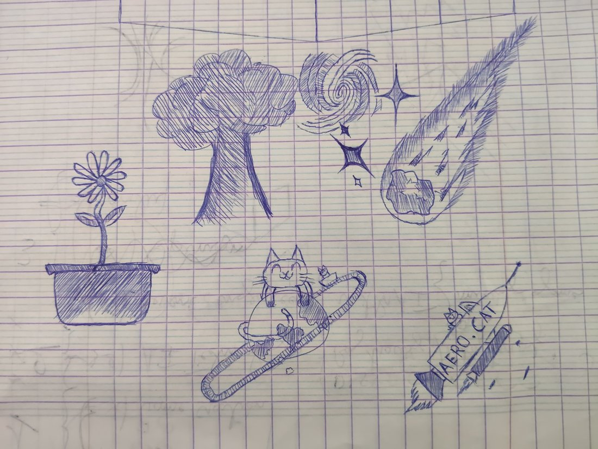
  <br>
  <em>The original page: ballpoint pen on French-ruled notebook paper. All the drawings are by me.</em>
</p>

Every drawing on that page has a job in the game:

| Drawing | Becomes |
|---|---|
| 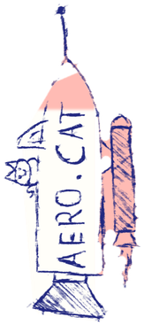 | **The AERO.CAT rocket**, the player's ship. Its flame is cut out separately so it can flicker, and its hand-lettered name became the title logo |
|  | **The comet**, the thing to dodge |
|  | **The galaxy**, the warp boost. It spins slowly |
|  | **The cat planet**, the shield pickup. It bobs up and down and meows when you touch it |
|     | **The stars**, your fuel and your score. Four doodled stars, four sizes of reward |
| 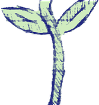 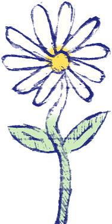 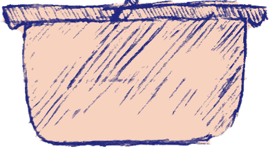 | **The flower pot**, split into pot, sprout and daisy: the first two garden stages |
| 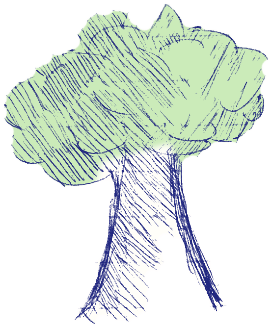 | **The tree**, which grows with your stardust |

The drawings were turned into game sprites by a small script, `tools/make_sprites.py`:

1. It stands the photo upright and evens out the lighting.
2. It keeps only the dark ballpoint ink. The printed grid and the old pencil marks are lighter, so they disappear.
3. It works out which drawing every stroke belongs to.
4. It fills each drawing with paper white and adds a light highlighter colour (yellow stars, green leaves, a blue planet, a terracotta pot).
5. It crops, turns and scales each sprite. The lossless originals go to `art/sprites/`, and the smaller files the game uses go to `game/assets/`.

---

## How it's made

- **The game** is plain JavaScript drawn on an HTML canvas. All the code, pictures and the font are bundled into a single HTML file.
- **The Android app** is a small Java wrapper (a WebView) around that same file. It adds saving, vibration, and the Back button. The same file also runs in a normal browser.
- **The APK** is built by one short script, with no Gradle, and GitHub builds it for you every time you push.
- **The sprites** are made from the photo by a small Python script.

Built with: HTML5 Canvas, vanilla JavaScript, Web Audio, Java (Android WebView), Python (NumPy, SciPy, OpenCV, Pillow), GitHub Actions, and the Patrick Hand font.

---

## Repository structure

```
aero-cat/
├── game/
│   ├── src/                 index.html, style.css, game.js  (the whole game)
│   ├── assets/              the 14 sprites (WebP)
│   ├── font/                Patrick Hand + its licence
│   └── build.py             bundles everything into docs/index.html
├── docs/index.html          the built game, one file (also used by GitHub Pages)
├── android/
│   ├── src/                 MainActivity.java (WebView + saving, vibration, Back button)
│   ├── res/                 launcher icons and theme
│   ├── AndroidManifest.xml
│   └── build.sh             builds and signs AeroCat.apk
├── art/
│   ├── original-drawing.jpg the photo of the original doodles
│   └── sprites/             the sprites, full quality, plus meta.json
├── tools/
│   ├── make_sprites.py      photo -> sprites
│   ├── make_icons.py        sprites -> app icons
│   └── requirements.txt
├── screenshots/             images used in this README
└── .github/workflows/
    └── build.yml            builds the APK on every push
```

---

## Getting started

### Run it in a browser

Open `docs/index.html`. If you change anything in `game/`, rebuild it with Python 3 (no extra packages needed):

```bash
python3 game/build.py        # -> docs/index.html
```

Commit the new `docs/index.html` together with your changes, so GitHub Pages shows the latest version.

### Build the Android APK

You need Ubuntu, Debian or WSL (on Windows) with these packages:

```bash
sudo apt install aapt apksigner zipalign android-sdk-platform-23 dalvik-exchange default-jdk-headless zip python3
bash android/build.sh        # -> android/AeroCat.apk
```

Or let GitHub do it: every push to `main` runs `.github/workflows/build.yml`, and the APK appears under that run's **Artifacts**.

### Signing

The signing key is never uploaded (`*.jks` is in `.gitignore`). `build.sh` signs with `android/aerocat.jks` and creates it the first time you build. Keep that file safe: Android only installs an update over an existing install if both were signed with the same key.

To sign the GitHub builds with your own key, add two repository secrets (**Settings → Secrets and variables → Actions**):

- `KEYSTORE_BASE64`: the output of `base64 -w0 android/aerocat.jks`
- `KEYSTORE_PASSWORD`: the keystore password

Without them, each GitHub build uses a new throwaway key. That's fine for testing, but you have to uninstall the old version before installing a new one.

### Remake the sprites and icons

```bash
pip install -r tools/requirements.txt
python3 tools/make_sprites.py   # photo -> art/sprites/*.png + game/assets/*.webp
python3 tools/make_icons.py     # -> app icons + screenshots/app-icon.png
```

---

## Lessons learned

- **A phone photo is not a scan.** The lighting is uneven across the page, so one brightness threshold can't work everywhere. Comparing each pixel with the paper right around it fixes that, and the lighter printed grid disappears for free.
- **Drawings that touch need a human.** A star touched an arm of the galaxy, and the flower stem touched the pot. So each stroke is assigned by hand-placed regions, and a few stray pixels are cleaned by script.
- **Not everything should be a sprite.** The little speed dashes next to the rocket looked blurry when scaled up, so the warp streaks are drawn as thin pen lines in code instead.
- **Balance by playing fast-forward.** Bots of different skill levels flew thousands of metres to tune how fast fuel runs out.

---

## Work in progress

**AERO.CAT is not finished.** It's playable from start to finish, but I'm still working on it.

**What works today**

- Flying, stars, comets, warnings, the galaxy warp and the cat shield
- The garden that grows, with perks
- Saving your best distance and stardust
- Sound, music and vibration
- Building the APK on GitHub

**Rough edges**

- Portrait only
- Mostly tested in a phone-sized browser, so more testing on real Android phones is needed
- No leaderboard and no cloud save
- Installing the APK shows an "unknown developer" warning

**Ideas for later**

- More of my doodles: new things to dodge, new pickups, new garden stages
- A daily challenge, the same for everyone
- A leaderboard
- French and Arabic text
- A Play Store release

---

## Privacy

- The app asks for **one** permission: vibration.
- It has no internet permission, so it never sends anything anywhere. No ads, no tracking.
- Your best distance, your stardust and your sound setting stay on your phone.
- Nothing is downloaded while you play: the font and every sprite are inside the app.

---

## Credits

**Art**: all the drawings are by me, drawn by hand in ballpoint pen on French-ruled notebook paper.

**Font**: [Patrick Hand](https://fonts.google.com/specimen/Patrick+Hand) by Patrick Wagesreiter, SIL Open Font License 1.1 (`game/font/OFL.txt`).

**Sound**: the music and effects are made live with the Web Audio API.

---

<div align="center">
  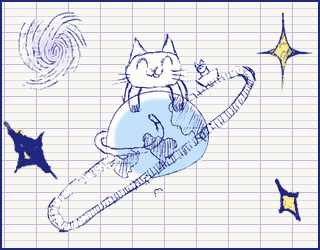
  <br>
  <sub><em>Fly high, little cat.</em></sub>
</div>
